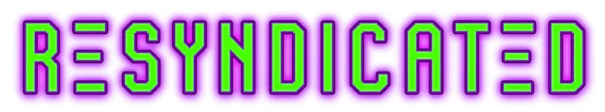

<p align="center">
  <picture>
    <source media="(prefers-color-scheme: dark)" srcset="data/resources/resyndicated_logo_black.png">
    <source media="(prefers-color-scheme: light)" srcset="data/resources/resyndicated_logo_white.png">
    
  </picture>
</p>

# ReSyndicated

ReSyndicated is a modern, open-source reimplementation of Bullfrog's classic cyberpunk strategy game *[Syndicate](https://en.wikipedia.org/wiki/Syndicate_\(1993_video_game\))* (and its expansion *[American Revolt](https://en.wikipedia.org/wiki/Syndicate:_American_Revolt)*). Built in C++20, it features hardware-accelerated SDL3 rendering, native audio stream mixing, and a full mission and map editor.

The game builds on Windows and macOS. On macOS the game uses native menus, and the mission editor runs through Wine. ReSyndicated requires the original game data files (art, audio, map, mission assets). However, the long term goal of this project is to fully rebuild the original assets to make ReSyndicated no longer reliant on copyrighted files and to "remaster" the game with modern high resolution graphics while retaining the original game's aesthetics, gameplay, storyline, and missions.

**Project**: [https://github.com/mork009/resyndicated/](https://github.com/mork009/resyndicated/)

ReSyndicated is forked off the [FreeSynd](https://freesynd.sourceforge.io/) open source project with heavy non-backwards compatible modifications and new capabilities.

## Why not just play FreeSynd?

FreeSynd is great and you should 100% support it. This project started as a fork from FreeSynd v0.9 and owes a lot to the authors of FreeSynd. That said, FreeSynd has different objectives and is moving at a slower pace than ReSyndicated. FreeSynd is largely a rendering engine but is missing significant parts of the in-game gameplay mechanics, particularly around AI behaviors. ReSyndicated was goaled on achieving 100% replicating original gameplay and full editing/creation, and has added 100+ commits while more than doubling the size of the codebase.

Main capabilities & features added in ReSyndicated:

- Full support for all versions of the original Syndicate, including the American Revolt expansion, and Syndicate Plus (a later release that bundled original Syndicate with American Revolt). FreeSynd expects a specific version of the original Syndicate and won't start without a CRC match on specific data files.

- A full editor with ability to create new maps/missions, edit existing ones, including setting mission objectives and properties, and all aspects of NPC behaviors. FreeSynd bundles an editor but it isn't an actual editor and only allows basic viewing of sprites, animations, and maps.

- A huge amount of AI logic implemented for NPCs, including routing for individual NPCs, vehicles, and enemy faction AI tactics, replicating complex NPC behaviors in the original game. Without these, missions are fundamentally broken.

- Calibrated weapon attributes and behaviors that mirror original game, including corrected weights, ammo, damage, range, raycasting for proper line-of-sight modeling, animations, and weapon specific behaviors like how wind affects the direction and range of the flamer. Also, added full support for American Revolt-specific items, Air Raid and Clone Shield.

- Calibrated NPC attributes like health, speeds, accuracy, and persuadability that mirror original game.

- Calibrated Intelligence, Perception, Adrenaline (IPA) effects on player's agents and NPCs, including corrections to panic behaviors.

- Improved/corrected pathing for NPCs and player's agents.

- Fixed vehicle pathing in numerous ways, including pedestrian yielding, traffic management & deadlock prevention, smoother transitions at intersections & turns, and transitions from stationary positions.

- Support for all vehicle types and NPC interactions, including full train running cycles with NPC onboarding and offboarding.

- A number of environment fixes, like correcting color palettes for each country.

- Upgraded SDL2 -> SDL3, modernizing the graphics engine.

- Simpler setup, e.g. no need to edit .ini files. Just run the game/editor, select the original game data files path, and you're off.

- New features not available elsewhere, like resizing windows, changing map zoom scale, enabling cheats at any time, and turning on object stats and path overlays.

## Why not just play the original with DOSBox (or the GOG version)?

Playing with DOSBox is the most authentic way to experience the original game, without a doubt. ReSyndicated is complementary to the original game, though the goal is to eventually supercede the original with a high resolution, modern, fully open source, community owned reimplementation of the game. ReSyndicated offers additional capabilities not available in the DOSBox/GOG version of the game, such as a native Windows rendering engine (i.e. not running in a DOS emulator), full map/mission editor, resizing the game window, zooming the map, enabling cheats at any time, turning on object stats / agent paths / tile coordinate overlays, quick launching directly into missions, and playing custom missions created in the editor.

## Where's the git history?

While this project was forked off FreeSynd v0.9, all the work was done offline until ReSyndicated reached a stable release (v1.0.0). During most of that time, the original Syndicate game assets were checked into git along with other private or copyrighted data. These were removed when the author decided to publish the project publicly but, of course, git history retains those files and makes them recoverable unless extra measures are taken to remove them from the history. Cleaning up git history for 100+ commits, some touching hundreds of files and tens of thousands of lines of code changes, would've added a lot of work with little benefit. So instead this project is being published with an initial commit that stacks all the changes that got the project to v1.0.0, and all future commits/releases will be published to the Github repo.

---

## License Information

ReSyndicated is released under the **GNU General Public License, Version 3**.  
See [`LICENSE.md`](LICENSE.md) for full license text and terms.

---

## Documentation Index

* **Changelog & Release Notes**: [`changelog.txt`](changelog.txt).
* **Character Stats & Behaviors**: [`docs/CHARACTERS.md`](docs/CHARACTERS.md).
* **Weapons Specification**: [`docs/WEAPONS.md`](docs/WEAPONS.md).
* **License**: [`LICENSE.md`](LICENSE.md).

---

## Installation & Setup

> **Original Syndicate Game Data Files Required**  
> Due to copyright and license restrictions, ReSyndicated does not distribute original *Syndicate* assets. You must provide a legally acquired copy of the original *Syndicate* game data files. All verions of the original *Syndicate* game, *American Revolt* expansion, and *Syndicate Plus* bundle are fully supported, including the [GOG version](https://www.gog.com/en/game/syndicate).

### Quick Start (Windows)

1. Download and extract the latest `.zip` [release](https://github.com/mork009/resyndicated/releases/) archive into your desired folder.

2. From your legal copy of the original *Syndicate*, *American Revolt*, or *Syndicate Plus*, copy the `DATA` folder to a destination of your choice (**recommended:** to your ReSyndicated installation directory). Note, the editor will allow you to make irreversible modifications to these files, so make sure you don't use your only copy of these files.

   **Note**: *Syndicate Plus* contains original *Syndicate* and *American Revolt* data files within the *Syndicate Plus* installation: `SYNDICAT\DATA` (*Syndicate*) and `DATADISK\DATA` (*American Revolt*). You can point to either of these directories to activate the missions and weapons/items for either the original game or the expansion.

3. Run the game or editor. At this time, the binaries are unsigned and will display a "Windows protected your PC" warning. This just means Microsoft has not certified the authenticity of the binary. We will attempt to get the binaries signed with Microsoft at a later time. For now, to proceed you have to click "More info" and then "Run anyway". The code is open source and available for anyone to verify it is benign.

4. Upon first run, the game/editor will ask you to select the `DATA` folder from step 2 and will indicate (a) if all the necessary files are present and (b) which version of Syndicate you've pointed to. You can change the `DATA` folder path later via the `File -> Settings...` menu in the game and editor.

### Building the game on macOS

With Xcode Command Line Tools and Homebrew installed, run these commands from the repository root.

```sh
brew install cmake ninja sdl3 sdl3_image libpng cli11 utf8cpp tracy catch2
cmake -S . -B build/macos -G Ninja -DCMAKE_BUILD_TYPE=Release
cmake --build build/macos
open build/macos/game/ReSyndicated.app
```

On first launch, select the `DATA` folder from your copy of *Syndicate* or *American Revolt*. The game saves this choice in `~/.resynd/resynd.conf`. To change folders later, choose **File → Settings** (⌘,). The **View** menu controls window size, map zoom and fullscreen. **Debug** contains the overlays and cheats.

The app uses the Homebrew runtime libraries installed on the build machine. For command-line options, run `build/macos/game/ReSyndicated.app/Contents/MacOS/ReSyndicated --help`. To run the tests with your game data, use `RESYND_DATA_DIR="/path/to/DATA" ctest --test-dir build/macos --output-on-failure`.

### Running the mission editor on macOS

After configuring the macOS build above, build and open the editor separately.

```sh
cmake --build build/macos --target resynd_editor
open "build/macos/editor/ReSyndicated Editor.app"
```

This target packages the upstream Windows v1.0.0 editor, its matching game for F5 playtesting, and Wine 11.21 in one app. The first build downloads about 233 MB and checks both archives against pinned SHA-256 hashes. Apple Silicon requires Rosetta. [Editor release](https://github.com/mork009/resyndicated/releases/tag/v1.0.0) · [Wine runtime](https://github.com/Gcenx/macOS_Wine_builds/releases/tag/11.21)

On first launch, the editor uses the native game's configured `DATA` folder if available. The editor can overwrite mission files, so choose a working copy for editing. You can pass a Mac folder path directly when launching the editor.

```sh
open "build/macos/editor/ReSyndicated Editor.app" --args --data "/path/to/working copy/DATA"
```

The editor keeps its Windows settings in a dedicated Wine prefix under `~/Library/Application Support/ReSyndicated/EditorWine`. In its file picker, drive `Z:` corresponds to the Mac filesystem. The editor accepts the Windows shortcuts listed below, including Ctrl+S to save and F5 to playtest.

### Building from Source (Windows)

#### Prerequisites

* **Operating System**: Windows 10 or Windows 11 (x64)
* **Compiler**: Microsoft Visual Studio 2022+ (Community, Professional, or Enterprise) with the **Desktop development with C++** workload installed
* **Build System**: CMake (v3.28+) and Ninja
* **Package Manager**: Conan 2.x (installed in your Python environment: `pip install conan`)
* **Latest Source Code** archive from https://github.com/mork009/resyndicated/

#### Build Instructions

Run the build script from the repository root:

```cmd
:: Build Debug configuration (default)
build.bat debug

:: Build Release configuration (optimized)
build.bat release

:: Re-run CMake configuration preset
build.bat debug --configure

:: Package release distribution into a standalone ZIP
build.bat package
```

#### Running Unit Tests

Execute the comprehensive Catch2 test suite (`test-engine.exe` and `test-kernel.exe`):

```cmd
:: Run all tests under Debug
test.bat debug

:: Run all tests under Release
test.bat release

:: Run specific test cases by name or tag filter
test.bat debug "PedAction"
test.bat debug "Vehicle"
```

---

## Audio Subsystem

ReSyndicated features a modern, high-fidelity audio engine powered by native SDL3 audio streams:

* **Authentic OPL3 FM Synthesis**: Integrates libADLMIDI with Nuked OPL3 emulation using original Bullfrog Miles Design Audio Interface Library (AIL 2.0) sound bank 19, delivering identical FM music playback to DOS Sound Blaster 16 and AdLib cards.
* **Built-in Creative Voice (.VOC) Decoder**: Directly parses Bullfrog's original 8-bit unsigned `.VOC` audio chunks (types 1, 2, 3, 8, and 9) across `SOUND-0.DAT`, `SOUND-1.DAT`, `ISNDS-0.DAT`, and `ISNDS-1.DAT`, cleanly resampling them to your operating system's native playback sample rate without external mixer dependencies.
* **Multi-Channel Sound Effects**: 32 independent dynamic audio channels with volume scaling for simultaneous weapon fire, explosions, speech clips, vehicle engines, and ambient cues.

---

## Configuration Files & Settings

ReSyndicated stores all persistent settings in a single shared configuration file generated automatically on first launch at `%USERPROFILE%\.resynd\resynd.conf` (or the directory passed via `--conf`):

* **`[Paths]`** (shared by both `resynd_game.exe` and `resynd_editor.exe`):
  * `data_dir`: User-configured original Syndicate `DATA` directory.
  * `data_signature`: Fast structural hash of verified assets to bypass full validation scans on subsequent startups.
* **`[Game]`** (`resynd_game.exe` settings):
  * `play_intro`: (`true`/`false`) Controls whether intro FLI movies play on startup (default: `true`).
  * `test_data`: (`true`/`false`) Forces deep structural verification of data assets on launch.
  * `language`: Language selector (`0` = OS locale, `1` = French, `2` = Italian, `3` = German, `4` = English).
  * `save_data_dir`: Custom directory path for save game files.
  * `sound_volume`: Global sound effects volume level (`0` to `128`).
  * `time_for_click`: Timeout (ms) to distinguish between click and drag events (default: `80`).
  * `menu_animation_speed`: UI animation speed multiplier (default: `1.5`, set to `1.0` for original DOS speed).
  * `pause_panning`: (`true`/`false`) Allows camera map panning while the game is paused (default: `false`).
* **`[EditorWindow]`**, **`[Loadout]`**, and **`[Playtest]`** (`resynd_editor.exe` window layout and playtest squad/launch settings).

### Saved Games

Saved games are stored in `%USERPROFILE%\.resynd\save\` (or the custom `save_data_dir` configured in `resynd.conf`).

---

## Command Line Options

### Game (`resynd_game.exe`)

| Option | Alternative      | Argument   | Description                                                                                   |
|:------ |:---------------- |:----------:|:--------------------------------------------------------------------------------------------- |
| `-h`   | `--help`         | None       | Display command line options and exit.                                                        |
| `-u`   | `--conf`         | `<path>`   | Specify directory path containing `resynd.conf` configuration file.                           |
| `-d`   | `--data`         | `<path>`   | Specify directory path containing original Syndicate data files.                              |
| —      | `--settings`     | None       | Open graphics and data path setup dialog on launch.                                           |
| `-n`   | `--nosound`      | None       | Disable all audio and music playback.                                                         |
| `-f`   | `--fullscreen`   | None       | Start the game in fullscreen mode.                                                            |
| `-m`   | `--mission`      | `<id>`     | Jump directly to specified campaign mission briefing (1–50).                                  |
| `-c`   | `--cheat`        | `<codes>`  | Enable colon-separated list of active cheat codes at launch.                                  |
| `-w`   | `--window-scale` | `<scale>`  | Set initial window scale factor (1–4) or custom dimensions (e.g. `1280x960`).                 |
| `-z`   | `--map-zoom`     | `<factor>` | Set initial map zoom multiplier (e.g. `1.0`, `1.5`, `2.0`).                                   |
| `-l`   | `--log`          | `<flag>`   | Apply colon-separated logging flags in Debug builds (`ALL`, `GAME`, `GFX`, `SND`).            |
| `-L`   | `--loadout`      | `<path>`   | Specify custom squad weapons and cyberware loadout descriptor file.                           |
| —      | `--show-coords`  | None       | Display isometric tile coordinates in the viewport.                                           |
| —      | `--show-paths`   | None       | Render active agent waypoint and navigation path vectors.                                     |
| —      | `--show-stats`   | None       | Render floating health and loadout badges for all peds and vehicles.                          |
| `-D`   | `--mission-dir`  | `<path>`   | Specify custom directory containing mission triads (`gameXX.dat`, `mapXX.dat`, `missXX.dat`). |

### Editor (`resynd_editor.exe`)

| Option | Alternative    | Argument | Description                                            |
|:------ |:-------------- |:--------:|:------------------------------------------------------ |
| `-h`   | `--help`, `/?` | None     | Display editor usage and command line options.         |
| `-m`   | `--mission`    | `<id>`   | Open specified mission ID directly (1–50).             |
| `-d`   | `--data`       | `<path>` | Specify path to original Syndicate `DATA` directory.   |
| —      | `--settings`   | None     | Open data setup dialog directly before loading editor. |

---

## Game (`resynd_game.exe`)

### Main Menu Shortcuts

* `F1` : **Configure Company** (Squad management, weapon armory, research, cybernetic mods)
* `F2` : **Begin Mission** (World map territory selector and tax rate manager)
* `F3` : **Load Custom Mission** (Browse and launch custom mission files)
* `F4` : **Load and Save Game** (Game session management)
* `F5` : **Restart Game**
* `F6` : **Quit Game / Quit to DOS**

### Window Menu Bar

* **File**: `Settings...` (Configure data path and options), `Exit`
* **View -> Size**: Window scaling factors `1x` (640×480), `2x` (1280×960), `3x` (1920×1440), `4x` (2560×1920), `Fullscreen` (`F11`)
* **View -> Zoom**: Map zoom levels from `0.25x` to `4.0x`
* **Debug**:
  * **Cheats**: `Invulnerability`, `Infinite Ammo`, `Money`, `Reveal Map`, `Quick Kill`
  * `Show Coordinates`, `Show Agent Paths`, `Show Stats`
* **Help**: `About`

### Global Audio Controls

* `+` / `-` : Increase / decrease sound effects volume
* `Shift +` / `Shift -` : Increase / decrease music volume
* `F9` : Toggle music mute on/off
* `F10` : Toggle sound effects mute on/off

### In-Game Controls

* `1` – `4` : Select individual agent.
* `0` : Select all agents or toggle leader squad grouping.
* `F1` – `F8` : Toggle items in active squad inventory slots.
* `Ctrl + D` : Trigger emergency self-destruction on selected agent(s) equipped with Chest Mod V2 or V3.
* `P` : Pause / unpause game.
* `Left Click` : Move, target enemy, interact with objects, enter/exit vehicles.
* `Right Click` on inventory slot : Drop weapon or item to the ground.
* `Right Click` on mini-map : Center camera view on clicked coordinates.

### Debug Cheat Codes

Setting Company Name in the game enables the follow cheats (per the original Syndicate game).

* `COOPER TEAM` / `MARKS TEAM` : Grants $100,000,000, unlocks all campaign missions, weapons, and cybernetic modifications.
* `ROB A BANK` : Grants $100,000,000 in credits.
* `DO IT AGAIN` / `JOLLY WOLLY` : Retry mission with current squad equipment; press `C` / `Ctrl+C` to instantly complete the mission.
* `WATCH THE CLOCK` : Accelerates research project progress.

---

## Editor (`resynd_editor.exe`)

ReSyndicated includes a full-featured, native Windows mission and map editor.

### Key Features

* **Interactive Map Editing**:
  - **Tile Painting**: Pencil tool (`P`) and Box Fill (`B`) for isometric terrain construction, with Select Tile (`V`) and Search (`S`).
  - **Categorized Palette**: Roads, Walls, Slopes, Roofs, and Specials with multi-palette environment support (`HPAL01.DAT` through `HPAL05.DAT`).
  - **Vertical Layer Slicing & 3D Wirebox Column**: Slice view / Z-isolation (`Z`) to isolate specific height layers (`Page Up` / `Page Down`). Interactive hover wiregrid highlights active layers and fades structures below.
  - **Tile Layer Manipulation**: Press `Shift + Page Up` / `Shift + Page Down` (`Shift + [` / `Shift + ]`) to raise or lower selected tiles vertically across Z layers.
* **Entity Management & Tactical Scripting**:
  - **Full Entity Suite**: Pencil tool (`P`), Select Entity (`V`), and Search (`S`) tools to place, select, edit, and search for characters, vehicles, and static objects.
  - **Character Route Tool (`R`)**: Place and manage waypoint routes with sub-tile positioning, walking, vehicle boarding, road driving, automated train station dwelling, unboarding, and looping patrol routes. Automatically tracks vehicle dependencies and prunes orphan passenger routes upon vehicle deletion.
  - **AI Tactics Editor**: Graphical management of 128 tactical faction-specific or global state chains (Seek & Destroy, Rival Sweep, Objective Sweep, Sentry Guard, Ambush, Patrol, Proximity Tripwire, Vehicle Boarding, Evacuation, and Delay Timers) with attributes defining targets, radii, timers, etc. that enables sophisticated AI behaviors.
* **Objective Scripting & Mission Properties**:
  - Add, edit, reorder, and configure all objective types: Assassinate, Persuade, Protect, Evacuate, Combat Sweep, Destroy/Use Vehicle.
  - Configure mission briefings, enhancement and info costs, mission cybernetics tech levels (Tier 0 Dynamic/Unaugmented, Tier 1 V1, Tier 2 V2, Tier 3 V3), custom per-agent cyberware overrides, and multi-language translations.
* **View Filters & Entity Overlays**:
  - **Entity Filters**: Toggle visibility under `View -> Filters` for Buildings/Structures, Vehicles, Civilians, Police, Guards, Criminals, Agents, and Weapon Drops.
  - **Live Entity Stats Overlay**: Toggle `View -> Show Stats` to display floating badges over entities with entity IDs, health meters, and weapon loadouts.
* **One-Click Playtesting**:
  - Press `F5` to validate mission playability and instantly launch the mission in `resynd_game.exe` using an isolated export directory without modifying base game files.
  - Customize squad loadouts and cybernetic modifications for playtesting via the Playtest Configuration dialog.

---

## Contact & Bug Reports

To contact the author of ReSyndicated or report bugs, please visit the Github project page at https://github.com/mork009/resyndicated/
